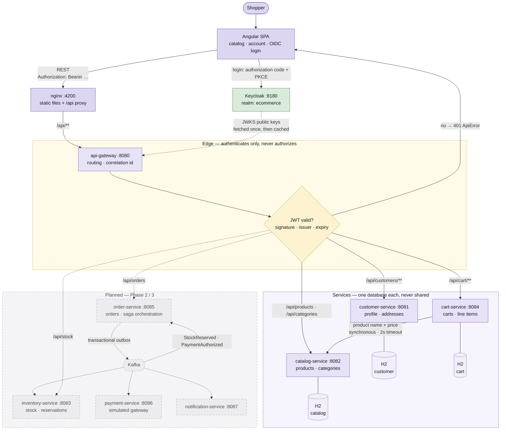

# Architecture diagram

Everything solid is implemented and running. The dashed group is designed but not
built — no message broker exists yet.

Three things the diagram is drawn to show:

- **Keycloak is not in the request path.** The dotted line into the gateway is a
  one-time public-key fetch, cached afterwards. Keycloak going down blocks new logins,
  not authenticated traffic.
- **The edge authenticates; services authorize.** The gateway checks that a token is
  genuine and rejects garbage early. Role checks (`@PreAuthorize`) live on the service
  methods, because a service must never trust a caller merely because the call came
  from inside the network.
- **Reads are synchronous, writes with side effects are events.** The only solid
  service-to-service arrow is `cart → catalog`, a read with a timeout. Every write path
  in the unbuilt half goes through Kafka instead.

Reasoning behind these choices: [architecture.md](architecture.md). Roadmap:
[PLAN.md](../PLAN.md).
